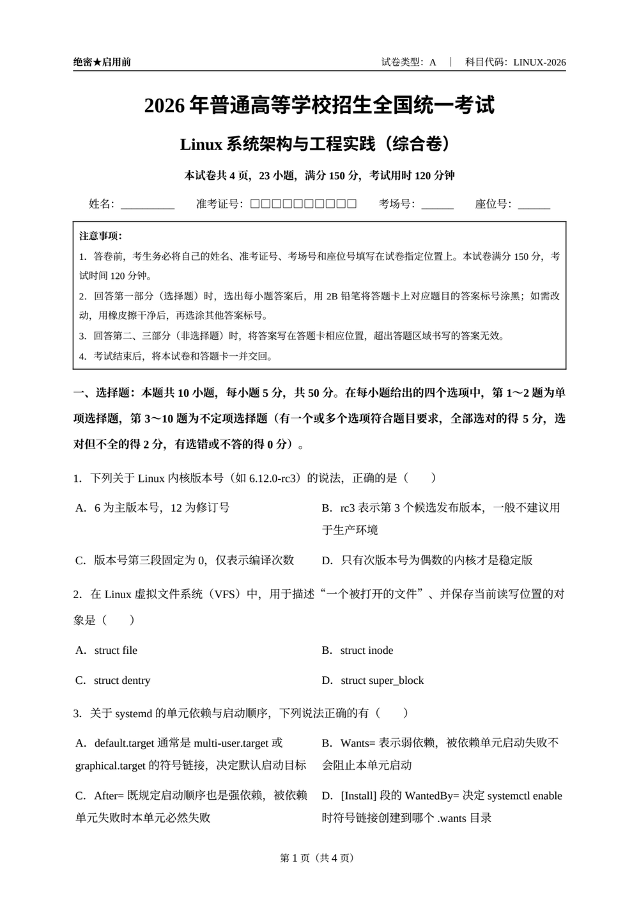
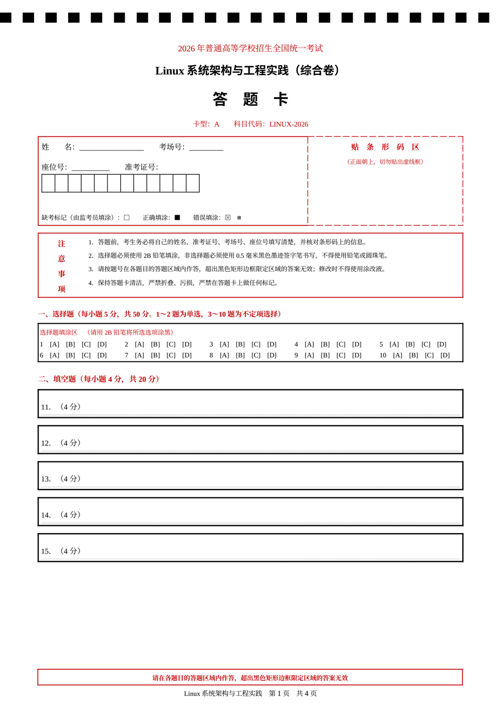

# dsh-skill-exam-paper-builder

[](LICENSE)
[](https://www.python.org/)

> 一条命令，把一份 JSON 题目配置渲染成 **高考样式的试卷 + 标准答题卡 + 参考答案与评分标准**（DOCX，可选 PDF）。
>
> A one-command generator that turns a JSON spec into a gaokao-style exam paper, a machine-readable answer sheet and an answer key (DOCX/PDF).

这是 [DeepSeek Harness](https://github.com/deepseek-ai/deepseek-harness) 的一个本地技能（skill）。装进 `~/.dsh/skills/` 后，直接说"出一套 Linux 卷子"就会自动加载。

## 预览

| 试卷（4 页） | 答题卡（4 页） |
|---|---|
|  |  |

## 特性

- **内容与版式分离**：模型只写 JSON（题干、选项、答案、评分点），脚本负责全部排版。
- **试卷**：A4 四页、页眉"绝密★启用前 ｜ 试卷类型 A ｜ 科目代码"、注意事项框、选择题 2×2 选项表、非选择题留白、页脚 `第 X 页（共 N 页）`。
- **答题卡**：黑白扫描定位条、12 格准考证号、贴条形码区、缺考标记图例、竖排"注意事项"、选择题填涂网格、每题独立黑色答题框（`cantSplit`，不会被拆页）。
- **参考答案**：4 列答案表 + 主观题要点 + 评分细则 + 灰底代码块（适合给命令/配置类答案）。
- **页数自校准**：导出 PDF 后统计真实页数并回写封面"本试卷共 N 页"，避免页数对不上。
- **中文字体安全**：每个 run 同时设置 `w:eastAsia`，宋体/黑体不会掉字体。

## 安装

```bash
git clone https://github.com/xiaopi668/dsh-skill-exam-paper-builder.git \
  ~/.dsh/skills/exam-paper-builder
```

依赖：

- `python-docx`（在 DSH 里用 `load_workspace_dependencies` 返回的解释器，自带该库）
- PDF 导出可选，需要 LibreOffice Kit CLI；缺失时脚本自动跳过，只产出 DOCX

## 快速开始

```bash
SKILL="$HOME/.dsh/skills/exam-paper-builder"
PY="python3"    # 换成装有 python-docx 的解释器

# 1. 先跑内置示例（Linux 卷，23 题 / 150 分 / 4 页）确认环境
"$PY" "$SKILL/scripts/build_exam.py" --demo --out exam_out

# 2. 换成自己的题目
"$PY" "$SKILL/scripts/build_exam.py" --spec exam_spec.json --out exam_out

# 3. 只要某几份 / 不要 PDF
"$PY" "$SKILL/scripts/build_exam.py" --spec exam_spec.json --out exam_out --only paper,card --no-pdf
```

一次产出 6 个文件：

```
exam_out/
├── <file_stem>.docx / .pdf          # 试卷
├── 答题卡.docx / .pdf                # 答题卡
└── 参考答案与评分标准.docx / .pdf     # 答案
```

## 配置长什么样

```jsonc
{
  "meta": { "subject": "Linux系统架构与工程实践", "paper_type": "综合卷",
            "paper_code": "LINUX-2026", "total_score": 150,
            "question_count": 23, "duration_min": 120, "pages": 4 },
  "notice": ["注意事项：", "1．答卷前……"],
  "sections": [
    { "type": "choice", "heading": "选择题", "instruction": "本题共 10 小题，每小题 5 分，共 50 分。",
      "questions": [ { "stem": "1．……（　　）", "options": ["……", "……", "……", "……"] } ] },
    { "type": "essay", "heading": "综合应用题", "instruction": "本题共 4 小题，共 48 分。",
      "points_each": 10,
      "questions": [ { "stem": "20．……", "score": "10 分", "lines": 9 } ] }
  ],
  "answer_key": {
    "choice": ["B", "A", "ABD"],
    "sections": [ { "heading": "二、填空题（每小题 4 分，共 20 分）",
                    "items": [ { "no": "11．", "text": "fd；cwd。", "points": "每空 2 分。" } ] } ]
  },
  "card": { "theme": "C00000", "choice_per_row": 5, "lines": { "short": 6, "essay": 9 } }
}
```

字段全表见 [references/spec.md](references/spec.md)；排版规则与踩坑记录见 [references/layout.md](references/layout.md)。

## 目录结构

```
.
├── SKILL.md                  # 技能入口：何时用、三步流程、已验证命令
├── scripts/build_exam.py     # 引擎：spec → 试卷/答题卡/答案（纯 python-docx）
├── assets/demo_linux_exam.json   # 示例配置（Linux 卷 23 题）
├── assets/preview-*.png      # 预览图
└── references/               # 字段参考、版式规则
```

## 实现要点（也是坑）

| 症状 | 原因 | 处理 |
|---|---|---|
| 表格塌陷、凭空多出十几页 | 重复追加 `w:tblW`/`w:tblLayout` | 复用已有节点，只改值 |
| 答题横线只剩最外两条 | 相邻段落同色边框被合并 | 逐段底边框 + 颜色奇偶微差 |
| 答题框被拆到两页 | 行未设 `cantSplit` | `no_split(row)` |
| 中文变成奇怪字体 | 只设了 `rFonts.ascii` | 同时设 `rFonts.eastAsia` |
| 封面页数与实际不符 | 静态写死 | 出 PDF 后数页回写重建 |

## License

[MIT](LICENSE) © 2026 xiaopi668
